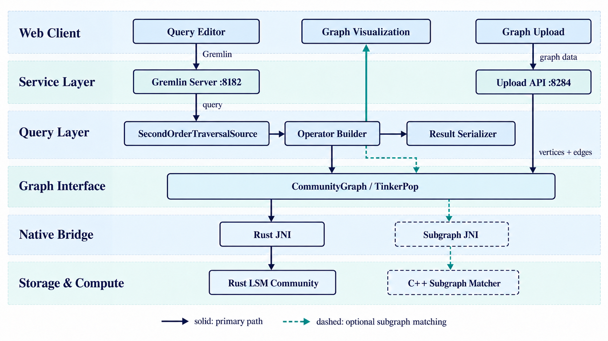

# MonacGraph 架构与 Gremlin 算子开发速览

本文介绍仓库**当前**的 TinkerPop/Gremlin 实现，供第一次阅读代码、实现图算子的同学使用。[图算子任务说明](operator-assignment.md)列出了待实现的算子；其中的框架替换任务完成后，本文的调用链需要同步更新。

## 1. 项目架构



图中展示当前基于 TinkerPop 的实现。查询经 Gremlin Server（8182）进入算子 Builder，通过 `CommunityGraph`、Rust JNI 访问 Rust 图存储；结果由序列化器返回网页。图上传使用独立的 8284 端口；C++ 子图匹配是可选路径。构建和启动命令见 [README](../README.md)。

## 2. Gremlin 语言入门

Gremlin 是 TinkerPop 的图遍历语言。图由**顶点**（`Vertex`）、**有向边**（`Edge`）以及标签、属性组成；查询通常从遍历源 `g` 开始，把步骤依次接在后面。本仓库在 `pom.xml` 中使用 TinkerPop 3.8.0。更完整的语法见 [Apache TinkerPop 3.8.0 参考文档](https://tinkerpop.apache.org/docs/3.8.0/reference/)。

```groovy
g.V()                                    // 从全部顶点开始
g.V(1)                                   // 从 ID 为 1 的顶点开始
g.V().has('name', 'Alice').out('knows')  // 找 Alice 沿 knows 出边到达的点
g.V(1).both().id().toList()              // 双向邻居的 ID 列表
g.E().count().next()                     // 边数
```

常用步骤：`V()` / `E()` 选起点，`has()` 过滤属性，`out()` / `in()` / `both()` 沿边行走，`values()` 取属性，`count()` 计数。`toList()`、`next()`、`iterate()` 用于取出或执行遍历结果。边有方向；即使业务上把关系视为无向，代码也应明确使用 `both()` 或 `Direction.BOTH`。

MonacGraph 的命名算子写法略有不同：

```groovy
g = graph.traversal(SecondOrderTraversalSource.class)
g.BFS(1).execute()         // Java/Gremlin 结果
g.BFS(1).executeForWeb()   // 网页可绘制的结果
```

这里的 `BFS()` 是 `SecondOrderTraversalSource` 上返回 Builder 的 **Java 方法**，`execute()` 才运行算法；它不是标准 Gremlin 的一步遍历。网页连接时会初始化扩展版 `g`，手动在服务端查询时也应先执行上面的初始化语句。

## 3. 在 MonacGraph 中注册一个算子

目标调用：`g.KHop(1).depth(2).executeForWeb()`。`KHop` 是[任务一](operator-assignment.md)中的待实现算子，以下只展示接入所需的关键代码。

### 1. `g.KHop(1)`：创建 Builder

在 `SecondOrderTraversalSource.java` 增加入口：

```java
// SecondOrderTraversalSource：g.KHop(1) 在这里创建 Builder
public KHopQueryBuilder KHop(Object id) {
    return new KHopQueryBuilder(this, id);
}
```

### 2. 在同一个 `KHopQueryBuilder` 类中完成链式调用

`so/KHopQueryBuilder.java` 的类骨架：

```java
public final class KHopQueryBuilder {
    private final GraphTraversalSource g;
    private final Object id;
    private int depth;
    // 保存起点；此时还不运行算法
    public KHopQueryBuilder(GraphTraversalSource g, Object id) { this.g = g; this.id = id; }
    // 保存跳数并返回当前对象，供后续链式调用
    public KHopQueryBuilder depth(int k) { this.depth = k; return this; }
    // 真正计算点集；expandWithin 是待实现的限深 BFS
    public Set<Vertex> execute() { return expandWithin(g.V(id).next(), depth); }
    // 将计算结果转成网页可绘制的数据
    public Map<String, Object> executeForWeb() {
        return VsetResultSerializer.serialize(ResultSubgraph.induced(execute()));
    }
}
```

### 3. 在网页中调用并核对结果

`web-client/src/App.vue` 的 `exampleQueries`：

```javascript
// 调用顺序：创建 Builder → 设置跳数 → 计算并序列化
{ title: 'KHop', query: 'g.KHop(1).depth(2).executeForWeb()' }
```

```text
示例小图：Alice(1) -knows→ Bob(2) -knows→ Charlie(3) -knows→ David(4)
g.KHop(1).depth(2).execute()       → {Alice(1), Bob(2), Charlie(3)}
g.KHop(1).depth(2).executeForWeb() → 上述 3 个点及前 2 条边
```

`mvn package` 并重启服务端后运行示例。
